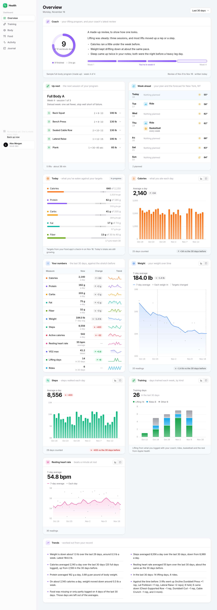

# Robot health: track your health by talking to a chatbot, see it on a dashboard

You keep your health record by talking to your AI chatbot: Claude, ChatGPT, GrokBot, or any
assistant that can add an MCP connector. "Update my health page." "What are my lifts today?"
"Leg press 270 for 8, 8, 7." "How was my week?" The chatbot reads and writes one database that
you own, on your own Cloudflare account.

That database is the **record**: your daily numbers from Apple Health, your weigh-ins and
workouts, your food against your targets, your lifting program and what you lifted, your plan
for the week, and your notes. The **dashboard** is a private website on top of it, for seeing
how you are doing.

- **A chat is the fastest way to put things in and ask questions.** No forms, no app to open.
- **A chat is a poor place to keep things.** It forgets, and every app keeps its own memory.
  Here the memory is your database, so you can switch chat apps, or use two, and lose nothing.
- **The rules live on your server, with tests.** How a day is counted, what "on target" means,
  how the next weight is suggested: worked out the same way whichever chat app asks.

This is a working app that one person built for himself without writing any code. He described
what he wanted to an AI (Claude Code), tried it, and said what was wrong. It is shared so you can
do the same. **Every number, name and note in this copy is made up.** It has a sister: a
[project dashboard](https://github.com/brianrenshaw/robot-dashboard-template) built the same
way for tasks and people.

## How you use it

### In your chatbot (where you work)

Connect it once (see "Make your own"). From then on, every chat knows how the record works,
because the server hands your chatbot standing instructions when it connects.

- **"Update my health page."** The chatbot reads Apple Health on your iPhone with its own Apple
  Health tool (the Claude and ChatGPT apps have one; GrokBot does not yet) and saves the numbers. The server applies the rules:
  dates in your time zone, kilograms to pounds, rounding, duplicates.
- **"I weighed 182.4 this morning."** A weight you say yourself.
- **Log your food in the app you like** (Carbon Diet Coach, MacroFactor or similar) and let it
  write to Apple Health; the sync brings it in. Send a screenshot of the app's check-in and
  your calorie and macro targets are saved, and each day's food is set against the targets that
  applied that day.
- **Your own library.** Load the resources you trust (your program's handbook, a training or
  nutrition book, articles from a site you trust) into the database. When you ask the coach a
  question, it looks it up there and answers from your sources, with the page or the link,
  instead of searching general health advice. If your sources do not cover it, it says so.
- **"What are my lifts today?"** Each lift in the session that is up, what you did last time,
  the weight to aim for today, and a link to a how-to video.
- **"I have 30 minutes."** The coach picks lifts to fit and leaves the session open for later.
- **"Plan my week: lift Monday morning, ride Tuesday, hike Saturday."** The week ahead shows the
  plan with the weather forecast, and which session falls on each lifting day.
- **"How was my week?"** The coach reads your lifts, rides, food, weight and notes together and
  writes a review, which is saved to the dashboard.
- **"That was wrong, undo it."**

After each change it answers in one line with a link to the dashboard.

### On the dashboard (where you look)

Six pages: Overview, Training, Body, Food, Activity and Journal. Headline numbers with their
change, real charts (weight, calories, macros, steps, resting heart rate, VO2 max, training
days), today's food against your targets, what is up next in the gym, the week ahead with the
forecast, each lift over time, trends worked out from your record, and the coach's latest
review. Last 30 days, 90 days or year.

It looks for one outside thing by itself, the weather forecast (US National Weather Service),
and sends nothing about you to get it. It never reads Apple Health; your chatbot does that, on
your phone, when you ask.

## What it took to get here (read this before you build your own)

The first version of almost every part was wrong, and the fixes are the useful part.
`CLAUDE.md` records each decision with its reason. The short list:

1. **The chatbot is the main way in; the website is for looking.** In the first owner's words:
   "It needs to be interactive with my chatbot, which will be kind of like my primary
   interaction, and use the site as a dashboard, database, and tracking to see how I'm doing."
2. **Write a spec for the data and say "follow it as written".** The first build improved on
   the spec (other table names, extra numbers) and had to be redone.
3. **The server applies the rules, not the chatbot.** The chatbot hands over what Apple Health
   returned, untouched; dates, units, rounding and duplicates are settled on the server, with a
   test for each rule. Chatbots are bad at arithmetic and each app does it differently.
4. **Missing is empty, never zero, and today is never finished.** A day with nothing logged is
   left out; today's running totals are never counted in an average.
5. **The coach never makes up what your sources say.** Load the books and articles you trust
   into the library; the coach looks the answer up and cites the page or link, or says your
   sources do not cover it. The suggested weight is worked out on the server, by the program's own rule.
6. **Sessions take turns, and you are never "behind".** Miss a day and the same session is
   still next. Nothing is skipped unless you say so.
7. **It is a dashboard in the full sense.** A quiet list of rows was "plain and empty"; the
   page now has headline numbers, charts, trends and a written review.
8. **Never delete, log everything, always offer undo.** That is what makes it safe to let an
   AI write to it.
9. **Keep a notes file for the AI.** `CLAUDE.md` is why a new AI session can fix this app
   without anyone explaining it again. Have your AI keep yours current.

## Make your own

You need a GitHub account, a Cloudflare account (the free plan is enough to start; the nightly
backup uses R2 storage, which Cloudflare may ask you to turn on with a payment method on file;
a record this size stays within its free allowance), a domain on Cloudflare for the website's address, and an AI coding tool such
as Claude Code. You do not need to know how to code.

1. Press **Use this template** at the top of this page and create your copy. Private is the
   safer choice. (Your data never goes into the repository: backups stay in your Cloudflare
   account.)
2. Open your copy in Claude Code (claude.ai/code, or the desktop app).
3. Say: **"Read SETUP.md and CLAUDE.md, then walk me through setting this up, one step at a
   time."**

To look at it first without setting anything up, ask your AI to "run this locally with the
sample program and made-up data, and show me screenshots". That needs no accounts.

## Then change it

It was built for one person's way of working, and yours is different. Tell your AI what you
want in plain words: "I don't lift, drop the coach", "I don't track fiber",
"I play tennis on Saturdays", "add sleep". Ask it to update `CLAUDE.md` as it goes. The
chatbot's standing instructions are in `workers/mcp/src/tools.ts`, and you can change those
the same way.

## What it is built with

Two Cloudflare Workers, one D1 database (SQLite) and one private R2 bucket for nightly backups.
One Worker is the website (React). The other is the MCP server your chatbot connects to; chat
apps sign in to it with OAuth after you sign in. Cloudflare Access makes sure only you can open
either. GitHub Actions run the checks and deploy on every push. `CLAUDE.md` has the full map.

## No promises

This is shared as an example, as it is. It works for the person it was built for. It is not
medical advice and not a medical device. Nobody is offering support for it. See `LICENSE`
(MIT): you may use it and change it freely.
